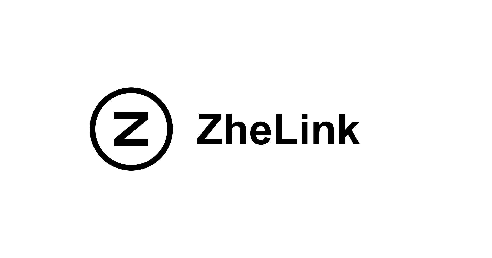

# ⚡ ZheLink

**A Simple, Speedy, Secure, and Serverless Link Shortener with Analytics, Running Entirely on Cloudflare.**

[Documentation](./docs/index.md) · [Deployment](./docs/deployment/workers.md) · [API Reference](./docs/api/index.md)




---

## ✨ Features

- **🔗 URL Shortening:** Compress your URLs to their minimal length.
- **📈 Analytics:** Monitor link analytics and gather insightful statistics.
- **☁️ Serverless:** Deploy without the need for traditional servers.
- **🎨 Customizable Slug:** Support personalized slugs, UTM parameters, and optional case-sensitive slug matching through configuration.
- **🪄 AI Assistance:** Optionally use Cloudflare Workers AI to generate slugs and OpenGraph metadata from page content.
- **⏰ Link Control:** Set expirations, passwords, and unsafe-link warning pages.
- **📱 Smart Routing:** Redirect visitors by device or country.
- **🖼️ Social Preview:** Customize social previews with titles, descriptions, and images.
- **📊 Near-real-time Analytics:** Display a live 3D globe and event logs using 10-second analytics polling and client-side replay, not SSE or WebSocket.
- **🔲 QR Code:** Generate QR codes for your short links.
- **📦 Import/Export:** Transfer links via JSON and export access analytics via CSV.
- **🌍 Multi-language:** Full i18n support for dashboard and redirect pages.

> [!TIP]
> **Who is ZheLink for?**
>
> ZheLink focuses on **individuals and small teams** who want a simple, self-hosted shortener on Cloudflare.

## 🪧 Dashboard

Open `/dashboard` on your deployed ZheLink instance and sign in using the `NUXT_SITE_TOKEN` configured for that instance.

See the [getting started guide](./docs/guide/getting-started.md) for setup instructions.

## 🧱 Technologies Used

- **Framework**: [Nuxt 4](https://nuxt.com/)
- **Database**: [Cloudflare D1](https://developers.cloudflare.com/d1/) is the authoritative link store; [Workers KV](https://developers.cloudflare.com/kv/) is a write-through read cache
- **ORM**: [Drizzle ORM](https://orm.drizzle.team/)
- **Analytics Engine**: [Cloudflare Workers Analytics Engine](https://developers.cloudflare.com/analytics/)
- **Object Storage**: [Cloudflare R2](https://developers.cloudflare.com/r2/) for optional logical JSON snapshots
- **AI**: Optional [Cloudflare Workers AI](https://developers.cloudflare.com/workers-ai/)
- **UI Components**: [shadcn-vue](https://www.shadcn-vue.com/)
- **Styling:** [Tailwind CSS](https://tailwindcss.com/)
- **Deployment**: [Cloudflare](https://www.cloudflare.com/)

## 🏗️ Deployment

ZheLink supports deployment to [Cloudflare Workers](./docs/deployment/workers.md) (recommended) and [Cloudflare Pages](./docs/deployment/pages.md) (deprecated).

> [!IMPORTANT]
> **Analytics is optional, but all three settings below are required to use it.** A working short link alone does not confirm that dashboard statistics are configured.
>
> | Setting              | What to configure                                                                                                            |
> | -------------------- | ---------------------------------------------------------------------------------------------------------------------------- |
> | `ANALYTICS`          | Analytics Engine binding; dataset `sink` by default. Keep it aligned with `NUXT_DATASET`.                                    |
> | `NUXT_CF_ACCOUNT_ID` | Runtime variable containing the Cloudflare account ID that owns the dataset.                                                 |
> | `NUXT_CF_API_TOKEN`  | Runtime encrypted secret containing a custom API token with **Account → Account Analytics → Read**, limited to that account. |
>
> On Workers, add the two `NUXT_CF_*` values under the Worker’s **Settings → Runtime variables and secrets → Production** (also called **Variables and Secrets**). Setting them only in **Builds** is insufficient. On Pages, use the project’s **Settings → Variables and Secrets → Production**. Save and deploy the changes.
>
> If either runtime credential is missing, analytics queries currently return `{"data":[]}` without a configuration error, so visits can appear as zero even when the binding has recorded them. Follow the [analytics setup and verification guide](./docs/features/analytics.md).

Local development requires Node.js 24 or newer and pnpm 11.11.0:

```bash
pnpm install
pnpm dev
```

The development server runs at `http://localhost:7465`.

## ⚒️ Configuration

[Configuration Docs](./docs/configuration/index.md)

## 🔌 API

[API Docs](./docs/api/index.md)

Open `/_docs/scalar` on your deployed ZheLink instance for the interactive API reference.

## 🤖 AI Skills

Install the repository's AI skills for ZheLink coding assistance by running this command from the repository root:

```bash
npx skills add .
```

## 🧰 MCP

ZheLink serves a built-in MCP endpoint at `POST /api/mcp`, using the official `@modelcontextprotocol/server` SDK v2, serving modern clients over the per-request transport and 2025-era clients over a stateless fallback with JSON responses.

> Replace `https://zhelink.example` with your deployed ZheLink URL, and replace `YOUR_SITE_TOKEN` with the `NUXT_SITE_TOKEN` from your instance's environment variables.

```sh
claude mcp add --transport http zhelink https://zhelink.example/api/mcp --header "Authorization: Bearer YOUR_SITE_TOKEN"
```

Any client that supports an HTTP transport with custom headers can connect the same way:

```json
{
  "mcpServers": {
    "zhelink": {
      "type": "http",
      "url": "https://zhelink.example/api/mcp",
      "headers": {
        "Authorization": "Bearer YOUR_SITE_TOKEN"
      }
    }
  }
}
```

It exposes tools for managing links (list, search, read, count, tag, create, update, upsert, delete) and for reading analytics (counters, views over time, and top values per dimension). See the [integrations documentation](./docs/integrations/index.md) for the full list.

## 🙋🏻 FAQs

[FAQs](./docs/faqs.md)

## 💖 Credits

1. [**Cloudflare**](https://www.cloudflare.com/)
2. [**NuxtHub**](https://hub.nuxt.com/)
3. [**Astroship**](https://astroship.web3templates.com/)
4. [**Tailark**](https://tailark.com/)

## 📄 License

[AGPL-3.0-only](LICENSE) © [miantiao-me](https://github.com/miantiao-me)
